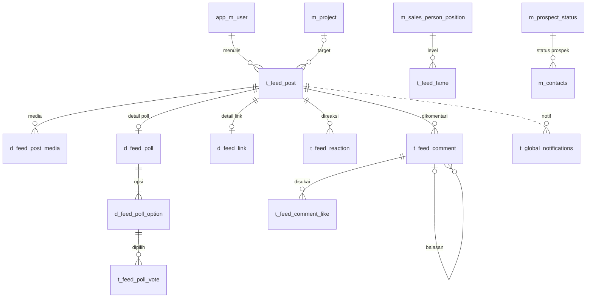
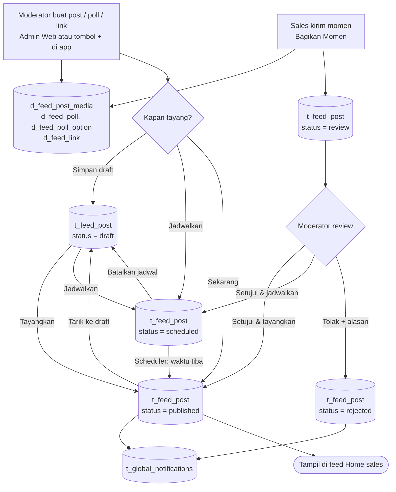
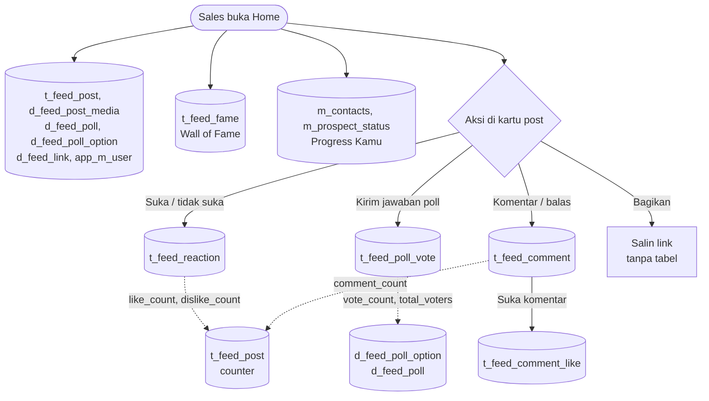

# ERD Marketing Feed

**Tanggal:** 2026-10-23
**Area:** `features/marketing-feed` (Flutter) + backend Laravel `Paradise-Connect-1.0`
**Status:** usulan. Tabel dan endpoint-nya belum ada; app masih memakai `MarketingFeedDummyDataSource`.
**Sumber:** [Marketing Feed Prototype.html](../Marketing%20Feed%20Prototype.html) (App Mobile + Admin Web) dan kontrak API di [marketing_feed_remote_datasource.dart](../lib/features/marketing-feed/data/datasources/marketing_feed_remote_datasource.dart).

## 1. Ringkasan

Marketing Feed adalah feed konten di Home aplikasi sales. Moderator (Tim Marketing) membuat post, poll, dan link sosmed dari Admin Web atau app. Konten bisa langsung tayang, dijadwalkan, atau disimpan sebagai draft. Sales mengirim momen lewat "Bagikan Momen"; kiriman itu masuk antrean review dulu sebelum tayang.

| Tabel | Jenis | Isi |
|---|---|---|
| `t_feed_post` | baru | Header semua konten: jenis, status, target project, pengaturan interaksi, jadwal, review |
| `d_feed_post_media` | baru | Foto/video carousel post, atau thumbnail link |
| `d_feed_poll` | baru | Detail poll (1:1 dengan post) |
| `d_feed_poll_option` | baru | Opsi jawaban poll |
| `t_feed_poll_vote` | baru | Suara per user per opsi |
| `d_feed_link` | baru | Detail link sosmed (1:1 dengan post) |
| `t_feed_reaction` | baru | Like / dislike post |
| `t_feed_comment` | baru | Komentar dan balasan (1 tingkat) |
| `t_feed_comment_like` | baru | Like komentar |
| `t_feed_fame` | baru | Peringkat Wall of Fame per bulan per level |
| `app_m_user` | existing | Penulis, pemberi reaksi, pemilih poll, pemberi komentar, juara |
| `m_project` | existing | Target project konten |
| `m_sales_person_position` | existing (pd_common) | Level Wall of Fame (GM/SM/SPV/SE) |
| `t_global_notifications` | existing | Riwayat notifikasi saat post tayang / kiriman direview |
| `m_contacts`, `m_prospect_status` | existing | Sumber hitungan "Progress Kamu" (tanpa tabel baru) |

## 2. ERD ringkas

Gambaran besar: hanya nama tabel dan relasinya. Kolom lengkap setiap tabel ada di §5.



- Setiap kotak adalah satu tabel. Teks di garis menjelaskan hubungannya, dibaca dari tabel asal ke tabel tujuan.
- Ujung garis menunjukkan jumlah: **dua garis tegak** = tepat satu, **lingkaran + garis tegak** = nol atau satu, **garis tegak + cakar** = satu atau banyak, **lingkaran + cakar** = nol atau banyak.
- Contoh: garis `t_feed_post` ke `t_feed_comment` berujung garis tegak di sisi post dan lingkaran + cakar di sisi komentar. Artinya 1 post punya 0 sampai banyak komentar.
- Garis putus-putus = hubungan tanpa FK. Di sini hanya notifikasi, yang menunjuk post lewat `link_url`.
- `app_m_user` juga dirujuk lewat `user_id` oleh `t_feed_poll_vote`, `t_feed_reaction`, `t_feed_comment`, `t_feed_comment_like`, dan `t_feed_fame`. Garisnya tidak digambar supaya diagram tetap terbaca; kolomnya ada di §5.
- Tabel existing (sudah ada di backend): `app_m_user`, `m_project`, `m_sales_person_position`, `t_global_notifications`, `m_contacts`, `m_prospect_status`. Sisanya tabel baru.

> Diagram Mermaid tampil langsung di GitHub/GitLab dan di tab **Database** prototype. Di VS Code, preview Markdown bawaan butuh ekstensi "Markdown Preview Mermaid Support".

## 3. Flowchart

Alur dari sisi pengguna. Bentuk silinder adalah tabel yang ditulis atau dibaca di langkah itu; garis putus-putus berarti update counter.

### 3.1 Alur konten

Dari dibuat moderator atau dikirim sales sampai tayang di feed.



### 3.2 Alur interaksi di feed

Yang terjadi saat sales membuka Home dan menyentuh kartu post.



## 4. Cara membaca ERD detail

Setiap kotak adalah satu tabel. Contoh kecil di bawah diambil dari ERD detail; angka di kanan menunjuk ke penjelasan di bawahnya.

```
┌─────────────────────────────────────────────┐
│ t_feed_post  [C/R/U/D]                      │         ← (1)
├─────────────────────────────────────────────┤
│ PK    feed_post_id                          │         ← (2)
│       status        draft | scheduled | ... │
├─────────────────────────────────────────────┤
│ INDEX idx_t_feed_post_feed (status, ...)    │         ← (3)
└─────────────────────────────────────────────┘
  │
  └─▶ 1:N  t_feed_post.feed_post_id                     ← (4)
           = t_feed_comment.feed_post_id
      ┌─────────────────────────────────────────────┐
      │ t_feed_comment  [C/R/U]                     │   ← (5)
      ├─────────────────────────────────────────────┤
      │ PK    feed_comment_id                       │
      │ FK    feed_post_id                          │
      └─────────────────────────────────────────────┘
```

1. **Nama tabel dan operasinya.** `[C/R/U/D]` artinya fitur Marketing Feed melakukan Create (insert), Read, Update, dan Delete di tabel ini. Tabel existing biasanya cuma `[R]`.
2. **Kolom.** Satu baris = satu kolom, seperti tabel di draw.io. Kiri: `PK` (kunci utama) atau `FK` (menyimpan id dari tabel lain). Tengah: nama kolom. Kanan: keterangan isinya.
3. **Index dan catatan.** Bagian bawah kotak, setelah garis pemisah, berisi `INDEX`, `UNIQUE`, dan aturan khusus tabel itu.
4. **Relasi.** `1:N` artinya 1 baris `t_feed_post` punya banyak baris `t_feed_comment`. Dua baris teks di sebelahnya adalah kolom penghubungnya, sama seperti `JOIN ... ON t_feed_post.feed_post_id = t_feed_comment.feed_post_id`. `N:1` kebalikannya (banyak baris menunjuk ke 1 baris), `1:1` artinya berpasangan satu-satu.
5. **Tabel anak** digambar menjorok di bawah tabel induknya. Garis `│` di kiri menyambungkan semua anak dari induk yang sama.

| Tanda | Arti |
|---|---|
| `C` `R` `U` `D` | Create (insert), Read (baca), Update (ubah), Delete (hapus). Dipakai juga di §6 |
| `(existing)` | Tabel sudah ada di database utama, hanya direferensikan |
| `(pd_common)` | Tabel ada di database `pd_common` (diakses lewat `db_pd_common()`). FK-nya FK logis, tidak dibuat constraint |

Untuk tahu tabel mana yang terpakai saat sesuatu diklik di prototype, lihat §6.

## 5. ERD detail

### 5.1 Konten & interaksi

```
┌─────────────────────────────────────────────────────────────────────────────┐
│ t_feed_post  [C/R/U/D]                                                      │
├─────────────────────────────────────────────────────────────────────────────┤
│ PK    feed_post_id                                                          │
│       post_type       post | poll | link                                    │
│       status          draft | scheduled | published | review | rejected     │
│       source          admin | mobile                                        │
│ FK    create_user_id  penulis / pengirim                                    │
│       is_official     1 = tampil sebagai "Progress Group Marketing"         │
│ FK    project_id      NULL = semua project                                  │
│       label           Shoutout, Poll, ..                                    │
│       pillar          opsional                                              │
│       body            caption / pertanyaan poll                             │
│       allow_like      izinkan like                                          │
│       allow_dislike   izinkan dislike                                       │
│       allow_comment   izinkan komentar                                      │
│       allow_reply     izinkan balasan (butuh allow_comment = 1)             │
│       allow_share     izinkan share                                         │
│       publish_at      jadwal / waktu tayang                                 │
│ FK    review_user_id  → app_m_user, moderator yang setuju / tolak           │
│       review_date                                                           │
│       reject_reason   tampil ke sales                                       │
│       like_count      counter                                               │
│       dislike_count   counter                                               │
│       comment_count   counter                                               │
│ FK    update_user_id  → app_m_user                                          │
│       created_at                                                            │
│       updated_at                                                            │
│       deleted_at      soft delete                                           │
├─────────────────────────────────────────────────────────────────────────────┤
│ INDEX idx_t_feed_post_feed (status, publish_at)                             │
│ INDEX idx_t_feed_post_project (project_id, status, publish_at)              │
│ INDEX idx_t_feed_post_user (create_user_id, status)                         │
└─────────────────────────────────────────────────────────────────────────────┘
  │
  ├─▶ N:1  t_feed_post.create_user_id
  │        = app_m_user.user_id
  │   ┌─────────────────────────────────────────────────────────────────────────────┐
  │   │ app_m_user  [R]  (existing)                                                 │
  │   ├─────────────────────────────────────────────────────────────────────────────┤
  │   │ PK    user_id                                                               │
  │   │       full_name        nama penulis                                         │
  │   │       photo            foto penulis                                         │
  │   │       sales_person_id  jabatan · project                                    │
  │   ├─────────────────────────────────────────────────────────────────────────────┤
  │   │ juga dirujuk oleh user_id di vote, reaksi, dan komentar                     │
  │   └─────────────────────────────────────────────────────────────────────────────┘
  │
  ├─▶ N:1  t_feed_post.project_id
  │        = m_project.project_id
  │   ┌─────────────────────────────────────────────────────────────────────────────┐
  │   │ m_project  [R]  (existing)                                                  │
  │   ├─────────────────────────────────────────────────────────────────────────────┤
  │   │ PK    project_id                                                            │
  │   │       project_name  PAR1, PAR2, PRC                                         │
  │   └─────────────────────────────────────────────────────────────────────────────┘
  │
  ├─▶ 1:N  t_feed_post.feed_post_id
  │        = d_feed_post_media.feed_post_id
  │   ┌─────────────────────────────────────────────────────────────────────────────┐
  │   │ d_feed_post_media  [C/R/D]                                                  │
  │   ├─────────────────────────────────────────────────────────────────────────────┤
  │   │ PK    feed_post_media_id                                                    │
  │   │ FK    feed_post_id                                                          │
  │   │       media_type          image | video                                     │
  │   │       file_path                                                             │
  │   │       mime_type           JPG / PNG / MP4                                   │
  │   │       size_bytes          maks 20 MB                                        │
  │   │       label               teks pengganti kalau gagal dimuat                 │
  │   │       sort_order          urutan carousel                                   │
  │   ├─────────────────────────────────────────────────────────────────────────────┤
  │   │ post: maks 10 file; link: 1 file sebagai thumbnail                          │
  │   └─────────────────────────────────────────────────────────────────────────────┘
  │
  ├─▶ 1:1  t_feed_post.feed_post_id
  │        = d_feed_poll.feed_post_id
  │   ┌─────────────────────────────────────────────────────────────────────────────┐
  │   │ d_feed_poll  [C/R/U]  (post_type = poll)                                    │
  │   ├─────────────────────────────────────────────────────────────────────────────┤
  │   │ PK,FK feed_post_id                                                          │
  │   │       is_multiple   boleh pilih > 1 jawaban                                 │
  │   │       image_path    gambar pertanyaan, opsional                             │
  │   │       total_voters  jumlah orang, bukan jumlah suara                        │
  │   └─────────────────────────────────────────────────────────────────────────────┘
  │     │
  │     └─▶ 1:N  d_feed_poll.feed_post_id
  │              = d_feed_poll_option.feed_post_id
  │         ┌─────────────────────────────────────────────────────────────────────────────┐
  │         │ d_feed_poll_option  [C/R/U]                                                 │
  │         ├─────────────────────────────────────────────────────────────────────────────┤
  │         │ PK    feed_poll_option_id                                                   │
  │         │ FK    feed_post_id                                                          │
  │         │       option_label                                                          │
  │         │       sort_order           index yang dikirim app saat vote                 │
  │         │       vote_count           counter                                          │
  │         ├─────────────────────────────────────────────────────────────────────────────┤
  │         │ minimal 2 opsi per poll                                                     │
  │         └─────────────────────────────────────────────────────────────────────────────┘
  │           │
  │           └─▶ 1:N  d_feed_poll_option.feed_poll_option_id
  │                    = t_feed_poll_vote.feed_poll_option_id
  │               ┌─────────────────────────────────────────────────────────────────────────────┐
  │               │ t_feed_poll_vote  [C/R]                                                     │
  │               ├─────────────────────────────────────────────────────────────────────────────┤
  │               │ PK    feed_poll_vote_id                                                     │
  │               │ FK    feed_poll_option_id                                                   │
  │               │ FK    feed_post_id         salinan, untuk cek sudah vote                    │
  │               │ FK    user_id              → app_m_user                                     │
  │               │       created_at           suara final, tidak bisa diubah                   │
  │               ├─────────────────────────────────────────────────────────────────────────────┤
  │               │ UNIQUE uq_t_feed_poll_vote (feed_poll_option_id, user_id)                   │
  │               │ INDEX idx_t_feed_poll_vote_user (feed_post_id, user_id)                     │
  │               └─────────────────────────────────────────────────────────────────────────────┘
  │
  ├─▶ 1:1  t_feed_post.feed_post_id
  │        = d_feed_link.feed_post_id
  │   ┌─────────────────────────────────────────────────────────────────────────────┐
  │   │ d_feed_link  [C/R/U]  (post_type = link)                                    │
  │   ├─────────────────────────────────────────────────────────────────────────────┤
  │   │ PK,FK feed_post_id                                                          │
  │   │       platform      youtube | blog | web                                    │
  │   │       url                                                                   │
  │   │       channel_name  mis. Progress Group Official                            │
  │   │       title                                                                 │
  │   │       description                                                           │
  │   └─────────────────────────────────────────────────────────────────────────────┘
  │
  ├─▶ 1:N  t_feed_post.feed_post_id
  │        = t_feed_reaction.feed_post_id
  │   ┌─────────────────────────────────────────────────────────────────────────────┐
  │   │ t_feed_reaction  [C/R/U/D]                                                  │
  │   ├─────────────────────────────────────────────────────────────────────────────┤
  │   │ PK    feed_reaction_id                                                      │
  │   │ FK    feed_post_id                                                          │
  │   │ FK    user_id           → app_m_user                                        │
  │   │       reaction          like | dislike                                      │
  │   │       created_at                                                            │
  │   │       updated_at                                                            │
  │   ├─────────────────────────────────────────────────────────────────────────────┤
  │   │ UNIQUE uq_t_feed_reaction (feed_post_id, user_id)                           │
  │   │ ganti reaksi = U, batal reaksi = D                                          │
  │   └─────────────────────────────────────────────────────────────────────────────┘
  │
  ├─▶ 1:N  t_feed_post.feed_post_id
  │        = t_feed_comment.feed_post_id
  │   ┌─────────────────────────────────────────────────────────────────────────────┐
  │   │ t_feed_comment  [C/R/U]                                                     │
  │   ├─────────────────────────────────────────────────────────────────────────────┤
  │   │ PK    feed_comment_id                                                       │
  │   │ FK    feed_post_id                                                          │
  │   │ FK    parent_comment_id  NULL = komentar utama                              │
  │   │ FK    create_user_id     → app_m_user, penulis komentar                     │
  │   │       is_official        komentar moderator                                 │
  │   │       body                                                                  │
  │   │       like_count         counter                                            │
  │   │       is_hidden          disembunyikan moderator                            │
  │   │ FK    hidden_user_id     → app_m_user                                       │
  │   │       hidden_at                                                             │
  │   │       created_at                                                            │
  │   │       updated_at                                                            │
  │   │       deleted_at         soft delete                                        │
  │   ├─────────────────────────────────────────────────────────────────────────────┤
  │   │ INDEX idx_t_feed_comment_post (feed_post_id, parent_comment_id, created_at) │
  │   │ C hanya kalau allow_comment = 1                                             │
  │   └─────────────────────────────────────────────────────────────────────────────┘
  │     │
  │     ├─▶ 1:N  t_feed_comment.feed_comment_id
  │     │        = t_feed_comment.parent_comment_id
  │     │   ┌─────────────────────────────────────────────────────────────────────────────┐
  │     │   │ t_feed_comment  (balasan)  [C/R]                                            │
  │     │   ├─────────────────────────────────────────────────────────────────────────────┤
  │     │   │ PK    feed_comment_id                                                       │
  │     │   │ FK    parent_comment_id  wajib komentar utama, balasan maks 1 tingkat       │
  │     │   ├─────────────────────────────────────────────────────────────────────────────┤
  │     │   │ C hanya kalau allow_comment = 1 dan allow_reply = 1                         │
  │     │   └─────────────────────────────────────────────────────────────────────────────┘
  │     │
  │     └─▶ 1:N  t_feed_comment.feed_comment_id
  │              = t_feed_comment_like.feed_comment_id
  │         ┌─────────────────────────────────────────────────────────────────────────────┐
  │         │ t_feed_comment_like  [C/R/D]                                                │
  │         ├─────────────────────────────────────────────────────────────────────────────┤
  │         │ PK    feed_comment_like_id                                                  │
  │         │ FK    feed_comment_id                                                       │
  │         │ FK    user_id               → app_m_user                                    │
  │         │       created_at                                                            │
  │         ├─────────────────────────────────────────────────────────────────────────────┤
  │         │ UNIQUE uq_t_feed_comment_like (feed_comment_id, user_id)                    │
  │         └─────────────────────────────────────────────────────────────────────────────┘
  │
  └─▶ 1:N  t_feed_post.feed_post_id
           = t_global_notifications.link_url (bukan FK)
      ┌─────────────────────────────────────────────────────────────────────────────┐
      │ t_global_notifications  [C]  (existing)                                     │
      ├─────────────────────────────────────────────────────────────────────────────┤
      │ PK    global_notification_id                                                │
      │       title                                                                 │
      │       description                                                           │
      │       target_type             all = post tayang, user = hasil review        │
      │       target_user_ids                                                       │
      │       link_url                buka post saat notif di-tap                   │
      ├─────────────────────────────────────────────────────────────────────────────┤
      │ link_url usulan: app://event/marketing_feed?feed_post_id=<id>               │
      └─────────────────────────────────────────────────────────────────────────────┘
```

### 5.2 Wall of Fame

```
┌─────────────────────────────────────────────────────────────────────────────┐
│ t_feed_fame  [C/R/U]  (Wall of Fame)                                        │
├─────────────────────────────────────────────────────────────────────────────┤
│ PK    feed_fame_id                                                          │
│       period                    tanggal 1 tiap bulan                        │
│ FK    sales_person_position_id  level GM / SM / SPV / SE                    │
│       ranking                   1 = juara, 2-3 = peringkat berikut          │
│ FK    user_id                                                               │
│       info                      teks jabatan · project                      │
│       highlight                 mis. "Naik 4 peringkat"                     │
│       score                     nilai dasar peringkat                       │
│ FK    create_user_id            → app_m_user                                │
│       created_at                                                            │
│       updated_at                                                            │
├─────────────────────────────────────────────────────────────────────────────┤
│ UNIQUE uq_t_feed_fame (period, sales_person_position_id, ranking)           │
└─────────────────────────────────────────────────────────────────────────────┘
  │
  ├─▶ N:1  t_feed_fame.sales_person_position_id
  │        = m_sales_person_position.sales_person_position_id
  │   ┌─────────────────────────────────────────────────────────────────────────────┐
  │   │ m_sales_person_position  [R]  (pd_common)                                   │
  │   ├─────────────────────────────────────────────────────────────────────────────┤
  │   │ PK    sales_person_position_id                                              │
  │   │       position_code             GM / SM / SPV / SE                          │
  │   │       position_name                                                         │
  │   │       priority                  urutan level di Wall of Fame                │
  │   └─────────────────────────────────────────────────────────────────────────────┘
  │
  └─▶ N:1  t_feed_fame.user_id
           = app_m_user.user_id
      ┌─────────────────────────────────────────────────────────────────────────────┐
      │ app_m_user  [R]  (existing)                                                 │
      ├─────────────────────────────────────────────────────────────────────────────┤
      │ PK    user_id                                                               │
      │       full_name                                                             │
      │       photo      foto juara                                                 │
      └─────────────────────────────────────────────────────────────────────────────┘
```

### 5.3 Progress Kamu (tanpa tabel baru)

Funnel pribadi (Leads → Appt → Visit → Reserve → SP) dihitung langsung dari data prospek milik sales yang login.

```
┌─────────────────────────────────────────────────────────────────────────────┐
│ m_contacts  [R]  (existing)                                                 │
├─────────────────────────────────────────────────────────────────────────────┤
│ PK    contact_id                                                            │
│ FK    sales_executive_id  = sales_person_id milik user login                │
│ FK    status_prospect_id                                                    │
├─────────────────────────────────────────────────────────────────────────────┤
│ Progress Kamu: TIDAK ada tabel baru                                         │
│ periode bulan berjalan, perlu konfirmasi                                    │
└─────────────────────────────────────────────────────────────────────────────┘
  │
  └─▶ N:1  m_contacts.status_prospect_id
           = m_prospect_status.prospect_status_id
      ┌─────────────────────────────────────────────────────────────────────────────┐
      │ m_prospect_status  [R]  (pd_common)                                         │
      ├─────────────────────────────────────────────────────────────────────────────┤
      │ PK    prospect_status_id                                                    │
      │       group_name          dipetakan ke Leads, Appt, Visit, Reserve, SP      │
      ├─────────────────────────────────────────────────────────────────────────────┤
      │ pemetaan perlu konfirmasi                                                   │
      └─────────────────────────────────────────────────────────────────────────────┘
```

## 6. Dipakai di mana

Setiap baris adalah satu klik atau tampilan di prototype (`Marketing Feed Prototype.html`, tab App Mobile dan Admin Web), beserta tabel yang dibaca (`R`) atau ditulis (`C`/`U`/`D`) backend saat itu terjadi. Di tab **Database** prototype, tabel ini bisa difilter per nama tabel.

### 6.1 App Mobile

Yang dilihat dan diklik sales (dan moderator lewat tombol +).

| Layar | Klik / tampilan | Tabel yang dipakai |
|---|---|---|
| Home | Buka app, kartu feed tampil | `R` `t_feed_post` (post published yang sesuai project user)<br>`R` `d_feed_post_media` (foto/video carousel, thumbnail link)<br>`R` `d_feed_poll` (detail poll)<br>`R` `d_feed_poll_option` (opsi dan jumlah suara)<br>`R` `t_feed_poll_vote` (jawaban saya (sudah vote atau belum))<br>`R` `d_feed_link` (kartu link sosmed)<br>`R` `t_feed_reaction` (reaksi saya (like/dislike))<br>`R` `t_feed_comment` (komentar terakhir di bawah post)<br>`R` `app_m_user` (nama dan foto penulis) |
| Home | Kiriman sendiri "Menunggu tinjauan" / "Ditolak" di atas feed | `R` `t_feed_post` (create_user_id = saya, status review/rejected, reject_reason) |
| Home | Kartu "Progress Kamu" | `R` `m_contacts` (kontak milik saya)<br>`R` `m_prospect_status` (dipetakan ke Leads → SP) |
| Home | Wall of Fame | `R` `t_feed_fame` (peringkat bulan ini)<br>`R` `m_sales_person_position` (label TOP GM/SM/SPV/SE)<br>`R` `app_m_user` (nama dan foto juara) |
| Kartu post | Tap Suka / Tidak suka | `C/U/D` `t_feed_reaction` (reaksi baru = C, ganti = U, batal = D)<br>`U` `t_feed_post` (like_count, dislike_count) |
| Kartu poll | Pilih jawaban, lalu Kirim Jawaban | `C` `t_feed_poll_vote` (1 baris per opsi yang dipilih)<br>`U` `d_feed_poll_option` (vote_count)<br>`U` `d_feed_poll` (total_voters) |
| Kartu post | Tap Bagikan | tidak ada (cuma menyalin link, tidak menyentuh database) |
| Kartu post | Buka komentar | `R` `t_feed_comment` (komentar dan balasannya)<br>`R` `t_feed_comment_like` (komentar yang sudah saya sukai)<br>`R` `app_m_user` (nama dan foto pemberi komentar) |
| Komentar | Kirim komentar | `C` `t_feed_comment` (parent_comment_id = NULL)<br>`U` `t_feed_post` (comment_count) |
| Komentar | Balas komentar | `C` `t_feed_comment` (parent_comment_id = id komentar yang dibalas)<br>`U` `t_feed_post` (comment_count) |
| Komentar | Suka komentar | `C/D` `t_feed_comment_like` (suka = C, batal = D)<br>`U` `t_feed_comment` (like_count) |
| Tombol + › Bagikan Momen | Kirim untuk Ditinjau | `C` `t_feed_post` (status review, source mobile)<br>`C` `d_feed_post_media` (foto/video yang diupload) |
| Tombol + › Post Baru | Publikasikan / Jadwalkan / Simpan Draft | `C` `t_feed_post` (status published / scheduled / draft)<br>`C` `d_feed_post_media` (foto/video carousel)<br>`C` `t_global_notifications` (hanya kalau langsung tayang) |
| Tombol + › Poll Baru | Publikasikan Poll | `C` `t_feed_post` (post_type poll)<br>`C` `d_feed_poll` (is_multiple, gambar pertanyaan)<br>`C` `d_feed_poll_option` (minimal 2 opsi)<br>`C` `t_global_notifications` (hanya kalau langsung tayang) |
| Tombol + › Draft & Terjadwal | Lihat daftar, Edit, Tayangkan, Hapus | `R` `t_feed_post` (status draft dan scheduled)<br>`U` `t_feed_post` (ubah isi atau status)<br>`D` `t_feed_post` (hapus = isi deleted_at) |

### 6.2 Admin Web

Menu Marketing Feed di panel admin, dipakai moderator.

| Layar | Klik / tampilan | Tabel yang dipakai |
|---|---|---|
| Konten | Buka daftar konten dan kartu Terjadwal / Draft / Menunggu Review | `R` `t_feed_post` (semua status, dihitung per status)<br>`R` `d_feed_post_media` (thumbnail)<br>`R` `d_feed_poll` (gambar poll sebagai thumbnail)<br>`R` `app_m_user` (teks "oleh ...") |
| Konten | Cari konten | `R` `t_feed_post` (body)<br>`R` `d_feed_link` (title) |
| Konten | Tayangkan / Tayangkan sekarang | `U` `t_feed_post` (status published, publish_at = sekarang)<br>`C` `t_global_notifications` (notif ke sales) |
| Konten | Batalkan jadwal / Tarik ke draft | `U` `t_feed_post` (status draft) |
| Konten | Hapus | `D` `t_feed_post` (soft delete (deleted_at)) |
| Buat Konten / Edit | Mengetik di editor (autosave) | `C/U` `t_feed_post` (tersimpan sebagai draft) |
| Editor | Jenis Post: upload atau hapus foto | `C/D` `d_feed_post_media` (urutan upload = sort_order) |
| Editor | Jenis Poll: pertanyaan, opsi, multi-jawaban | `C/U` `d_feed_poll` (is_multiple, gambar pertanyaan)<br>`C/U/D` `d_feed_poll_option` (tambah, ubah, hapus opsi) |
| Editor | Jenis Link Sosmed | `C/U` `d_feed_link` (platform, url, judul, deskripsi)<br>`C/U` `d_feed_post_media` (thumbnail) |
| Editor | Target project | `R` `m_project` (isi dropdown)<br>`U` `t_feed_post` (project_id (NULL = semua project)) |
| Editor | Pengaturan interaksi | `U` `t_feed_post` (allow_like .. allow_share) |
| Editor | Publikasikan / Jadwalkan | `U` `t_feed_post` (status, publish_at)<br>`C` `t_global_notifications` (hanya kalau langsung tayang) |
| Kalender Jadwal | Tab Draft / Terjadwal | `R` `t_feed_post` (status draft / scheduled) |
| Review Kiriman Sales | Buka daftar kiriman | `R` `t_feed_post` (status review)<br>`R` `d_feed_post_media` (foto kiriman)<br>`R` `app_m_user` (nama dan jabatan pengirim) |
| Review Kiriman Sales | Toggle "Izinkan komentar" | `U` `t_feed_post` (allow_comment, allow_reply) |
| Review Kiriman Sales | Setujui & tayangkan | `U` `t_feed_post` (status published, review_user_id, review_date)<br>`C` `t_global_notifications` (notif ke pengirim dan sales) |
| Review Kiriman Sales | Setujui & jadwalkan | `U` `t_feed_post` (status scheduled, publish_at, review_user_id) |
| Review Kiriman Sales | Tolak | `U` `t_feed_post` (status rejected, reject_reason, review_user_id)<br>`C` `t_global_notifications` (notif ke pengirim) |

### 6.3 Sistem

Berjalan otomatis di backend, tanpa klik.

| Layar | Klik / tampilan | Tabel yang dipakai |
|---|---|---|
| Scheduler (tiap menit) | Di prototype: jam simulasi dan tombol "Lompat ke jadwal berikutnya" | `U` `t_feed_post` (scheduled → published)<br>`C` `t_global_notifications` (notif ke sales) |
| Job bulanan | Wall of Fame, kalau dihitung otomatis | `C/U` `t_feed_fame` (lihat pertanyaan terbuka no. 1) |

## 7. Alur status `t_feed_post`

| Dari | Aksi | Ke | Oleh |
|---|---|---|---|
| (baru) | Simpan draft / autosave editor | `draft` | Moderator |
| (baru) | Publikasikan | `published` | Moderator |
| (baru) | Jadwalkan | `scheduled` | Moderator |
| (baru) | Bagikan Momen | `review` | Sales |
| `draft` | Tayangkan | `published` | Moderator |
| `draft` | Jadwalkan | `scheduled` | Moderator |
| `scheduled` | Waktu tayang tiba | `published` | Scheduler |
| `scheduled` | Tayangkan sekarang | `published` | Moderator |
| `scheduled` | Batalkan jadwal | `draft` | Moderator |
| `published` | Tarik ke draft | `draft` | Moderator |
| `review` | Setujui & tayangkan | `published` | Moderator |
| `review` | Setujui & jadwalkan | `scheduled` | Moderator |
| `review` | Tolak (alasan wajib) | `rejected` | Moderator |
| `draft`, `rejected` | Hapus | soft delete (`deleted_at`) | Moderator |

Setiap kali status berubah ke `published`, `publish_at` diisi waktu saat itu (kecuali yang tayang dari jadwal, yang memakai waktu jadwalnya).

## 8. Aturan bisnis

- **Scheduler** jalan tiap menit: `status = 'scheduled' AND publish_at <= NOW()` diubah ke `published`, lalu insert ke `t_global_notifications` dan kirim push.
- **Visibilitas feed:** `status = 'published' AND deleted_at IS NULL AND (project_id IS NULL OR project_id IN <project user>)`, urut `publish_at DESC`. Di halaman 1, kiriman milik user sendiri yang berstatus `review`/`rejected` ditaruh paling atas.
- **Edit post yang sudah tayang** langsung berlaku di app. `post_type` tidak boleh diganti.
- **Pengaturan interaksi** divalidasi di backend, bukan cuma di UI. Komentar butuh `allow_comment = 1`; balasan butuh `allow_comment = 1` dan `allow_reply = 1`. Like/dislike ditolak kalau `allow_like`/`allow_dislike` = 0.
- **Balasan komentar** maksimal 1 tingkat: `parent_comment_id` harus menunjuk komentar yang `parent_comment_id`-nya NULL.
- **Vote poll** final, tidak bisa diubah. Untuk poll pilihan tunggal (`is_multiple = 0`), maksimal 1 baris per (`feed_post_id`, `user_id`).
- **Reaksi:** 1 baris per user per post. Ganti like ↔ dislike = update; batal = delete.
- **Counter** (`like_count`, `dislike_count`, `comment_count`, `vote_count`, `total_voters`, `like_count` komentar) diupdate dalam transaksi yang sama dengan insert/delete interaksinya.
- **Media:** maksimal 10 file per post (JPG/PNG/MP4, maks 20 MB per file). Link hanya 1 file thumbnail.
- **Moderator** ditentukan lewat permission yang sudah ada (mis. `marketing-feed.moderate`), bukan kolom baru.

## 9. Konvensi kolom

- Kolom audit mengikuti tabel existing (`m_contacts`): `create_user_id`, `update_user_id`, `created_at`, `updated_at`, dan `deleted_at` untuk tabel yang memakai soft delete (`t_feed_post`, `t_feed_comment`).
- Nama index: `idx_<tabel>_<tujuan>`. Nama unique: `uq_<tabel>`.
- Kolom bernama `ranking`, bukan `rank`, karena `RANK` adalah reserved word di MySQL 8.

## 10. Pertanyaan terbuka

1. **Wall of Fame:** dihitung otomatis dari data SP (job bulanan) atau diisi manual oleh admin? Teks highlight di prototype terlihat ditulis manual. `t_feed_fame` bisa dipakai untuk dua-duanya.
2. **Target project:** cukup satu project atau semua? Kalau butuh beberapa project sekaligus, `project_id` diganti tabel pivot `d_feed_post_project`.
3. **Edit opsi poll setelah ada suara:** prototype mempertahankan suara selama jumlah opsinya sama. Ini berisiko kalau teks opsinya diganti. Usulan: opsi dikunci begitu ada suara.
4. **`pillar`:** ada di data prototype tapi tidak ada UI untuk memilihnya. Dipakai untuk laporan atau dibuang?
5. **Platform link:** Flutter saat ini hanya mengenal `youtube`/`web`, sedangkan prototype punya `blog`. Enum backend dan app perlu disamakan.
6. **Progress Kamu:** pemetaan `m_prospect_status` ke 5 tahap funnel, dan periode hitungnya (kontak dibuat bulan ini, atau status berubah bulan ini), perlu dikonfirmasi.
